<p align="center">
  
</p>

<p align="center"><b><i>"OK, fine, I'll remember it for you."</i></b></p>

<p align="center">
  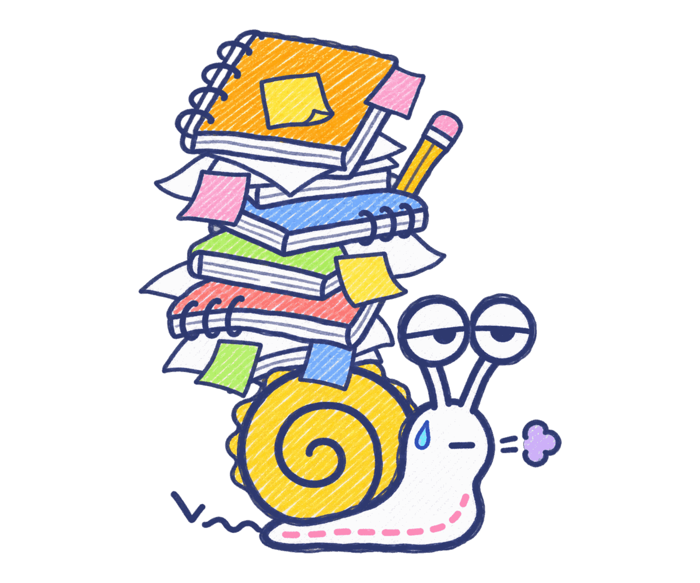
</p>

---

## Hi. I'm Okie. 🐌

I'm a snail. I'm tired. I've been tired since 2024.

Every day somebody asks *"wait, where did we write down how to deploy?"* or
*"who knows the printer password?"* or *"didn't we already decide this?"*

So I carry it all. Every note, every decision, every *"just so you know"*.
I put them in neat little notebooks, I link them together, and when you
forget (you will), I find them for you.

I'm slow. I'm sighing. But I never forget.

**OK, Fine Memory** is a little web app (and a bag of tools) where you and your
AI helpers keep what your team knows, and I keep it tidy.

<p align="center">
  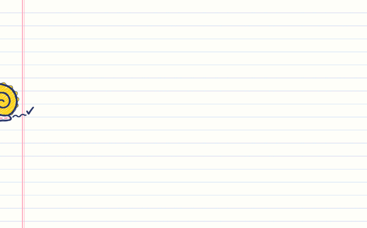
</p>

## What I do for you

<table>
  <tr>
    <td width="33%" align="center">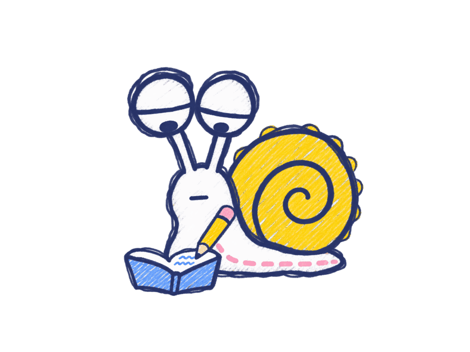<br><b>I write it down</b><br>Tell me once. I put it in a notebook, in the right folder, with a title and some tags.</td>
    <td width="33%" align="center">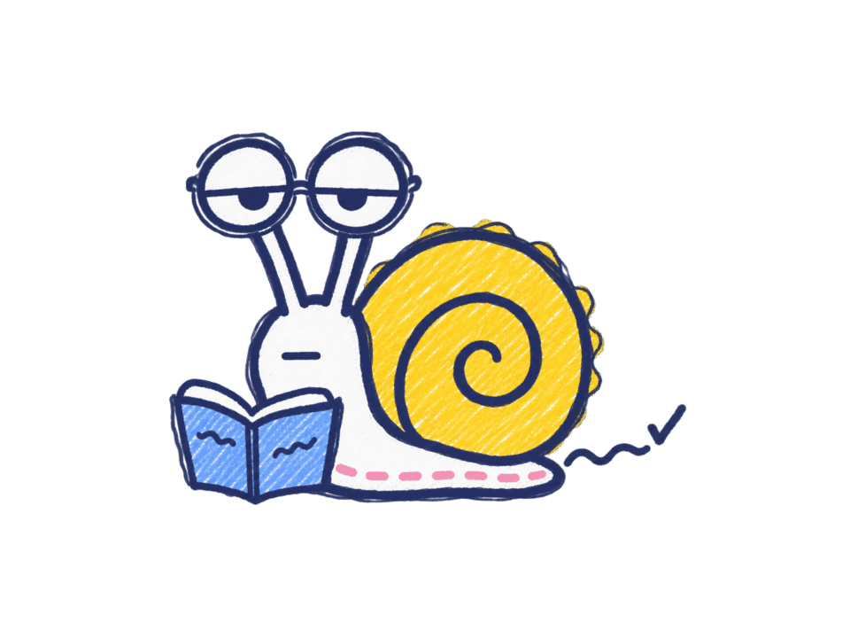<br><b>I find it again</b><br>Ask me in plain words. I go through every notebook. Slowly. Thoroughly.</td>
    <td width="33%" align="center">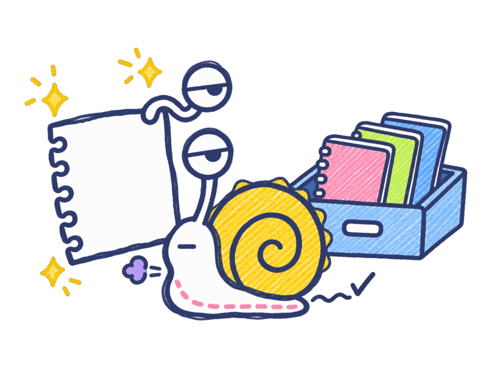<br><b>I connect the dots</b><br>Pages link to each other. I also tell you who links <i>back</i>, so nothing gets lonely.</td>
  </tr>
</table>

<p align="center">
  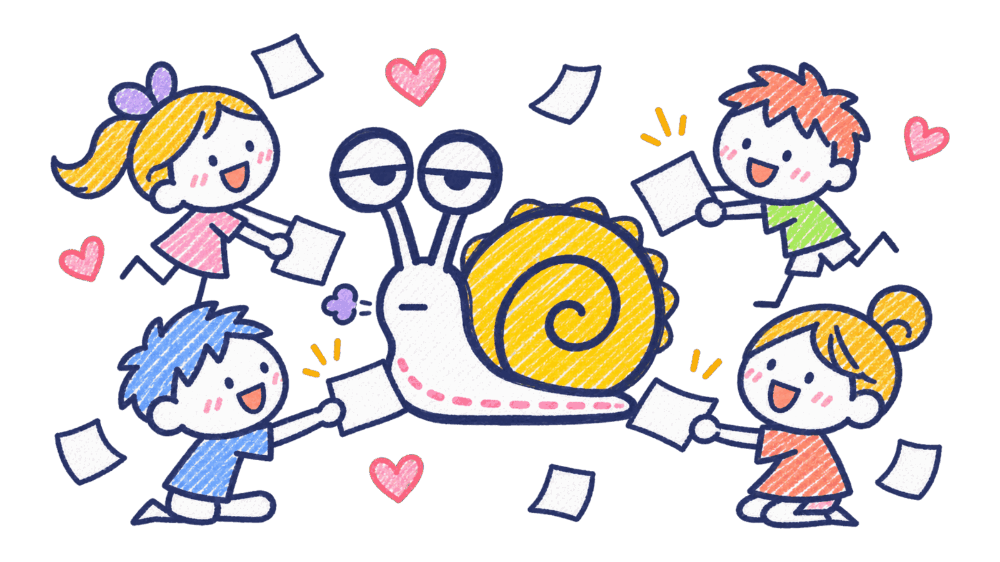<br>
  <i>Humans in the web app, AI agents through MCP. Everybody hands me notes. I take them all. <code>*sigh*</code></i>
</p>

## Take a look around

**Your workspaces.** One per team, project, or life choice. Each gets its own crayon colour.

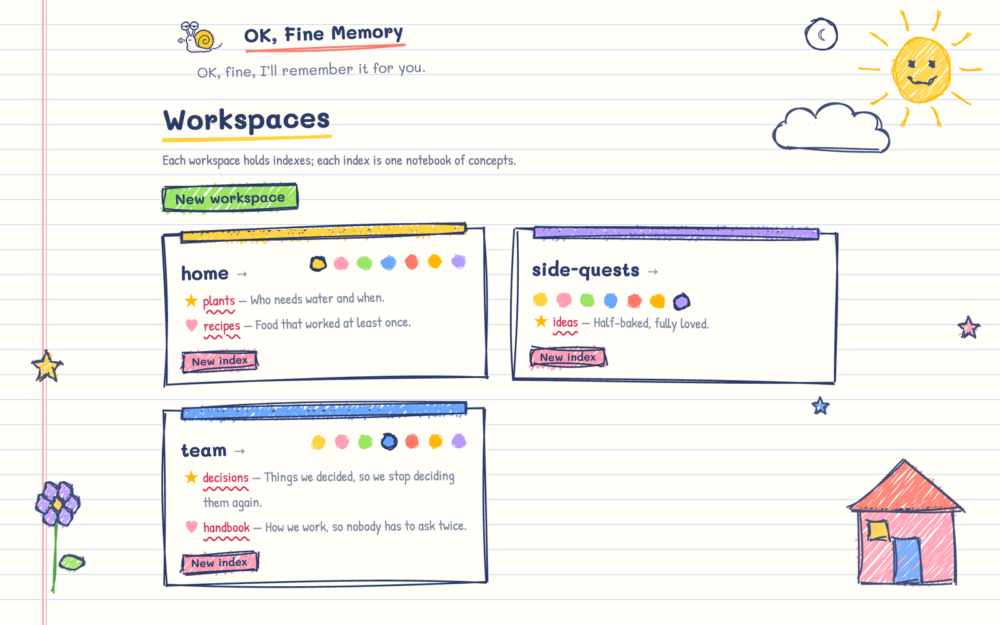

**Notebooks inside a workspace**, plus what I remembered most recently.

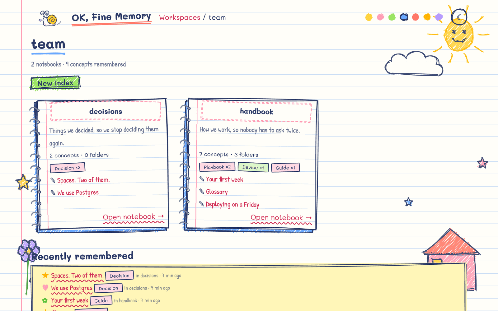

**A page.** The explorer on the left is an actual spiral notebook. You can drag pages into folders. I fix the links for you, you're welcome.

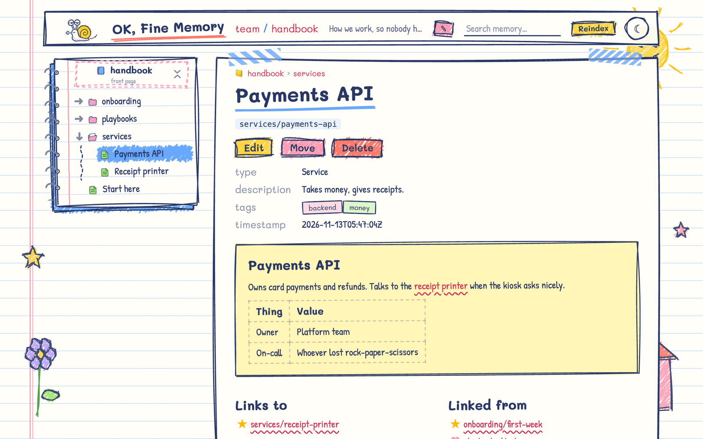

**Night shift.** The dark mode is a chalkboard, because I work late.

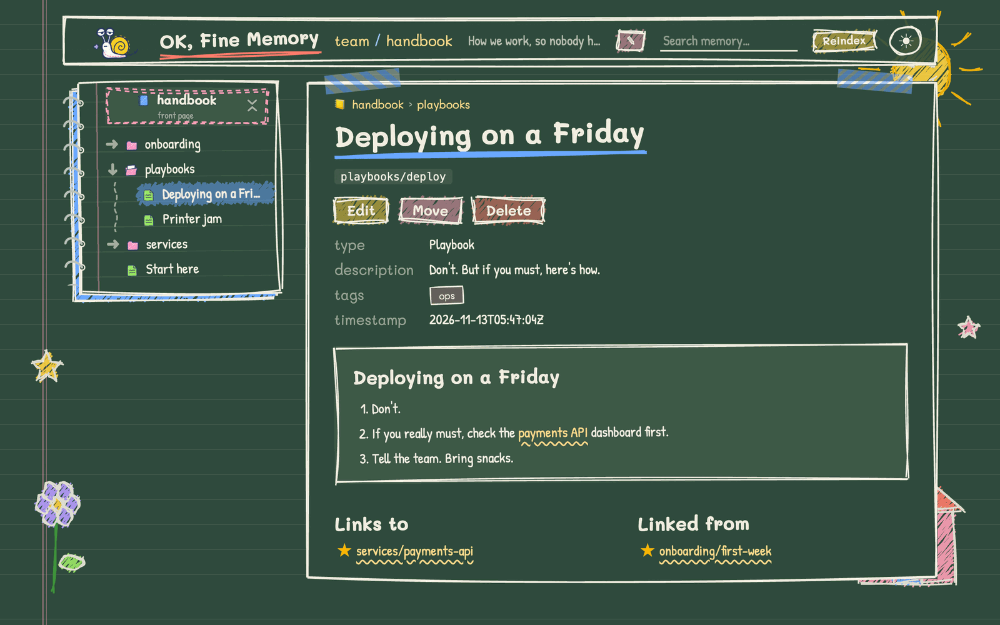

## The short list

- 📒 **Notebooks and folders.** Make them, fill them, drag things between them.
- ✏️ **Write in plain markdown.** Titles, tags, tables, links. It's just text files on your disk.
- 🔗 **Links both ways.** Every page shows what it links to and what links to it.
- 🔍 **Search in normal words.** Hook up a local embeddings server and ask away. (Without one, I nap.)
- 🤖 **AI agents can write too.** An MCP server lets Claude and friends add and fix pages in the same notebooks.
- 🖍️ **A crayon colour per workspace.** Seven to choose from. Choose wisely.
- 🌙 **Chalkboard dark mode.** Follows your system, or flip it with ☾.
- 🏠 **Everything stays on your computer.** No cloud, no account, no tracking. Just me.

## Wake me up (2 minutes)

You need [uv](https://docs.astral.sh/uv/) and [Bun](https://bun.sh/).

```bash
git clone https://github.com/hannguyendd/okf-sdk && cd okf-sdk
uv sync
cd packages/okf-web2 && bun install && bun run build && cd -
uv run okf-web --static packages/okf-web2/dist
```

Open **http://127.0.0.1:8765**, make a workspace, make a notebook, write something.
I'll take it from there.

Want the sales pitch first? My landing page lives at **http://127.0.0.1:8765/landing.html**.
I made it myself. With crayons.

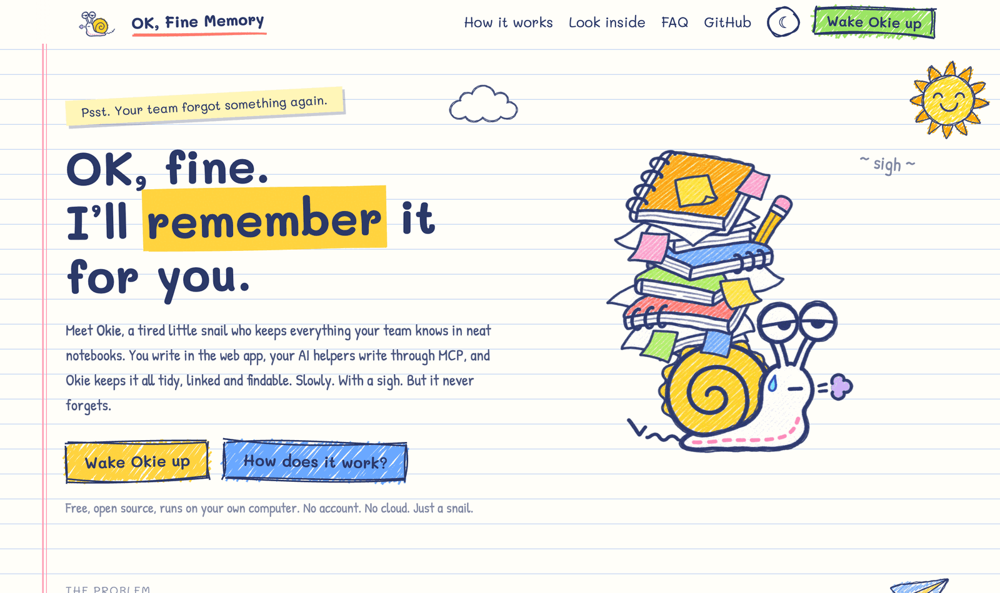

## Questions people ask me

**Why a snail?**
Because I'm slow, I carry my house around, and I leave a trail. Also nobody else wanted the job.

**Where do my notes actually go?**
Plain markdown files in `~/.okf/workspaces/`. Open them in any editor, put them in git, grep them.
I won't be offended. (I'll be a little offended.)

**Can my AI assistant use this?**
Yes. Plug the MCP server into Claude (or any MCP client) and it can read and write the same notebooks you see.
Setup is on [the boring page](docs/TECHNICAL.md#connect-an-ai-agent-mcp).

**Is it safe to put it on the internet?**
No. There's no login. Keep it on your machine. I'm a homebody.

**Why are you so tired?**
You'd be tired too.

## The boring stuff

Packages, architecture, MCP setup, search, file layout, tests, design docs:
👉 **[docs/TECHNICAL.md](docs/TECHNICAL.md)**

There's also the [brand guide](packages/okf-web2/brand/BRAND.md) (yes, I have one) and
the [OKF conformance rules](packages/okf-core/CONFORMANCE.md), if you're into that.

---

<p align="center">
  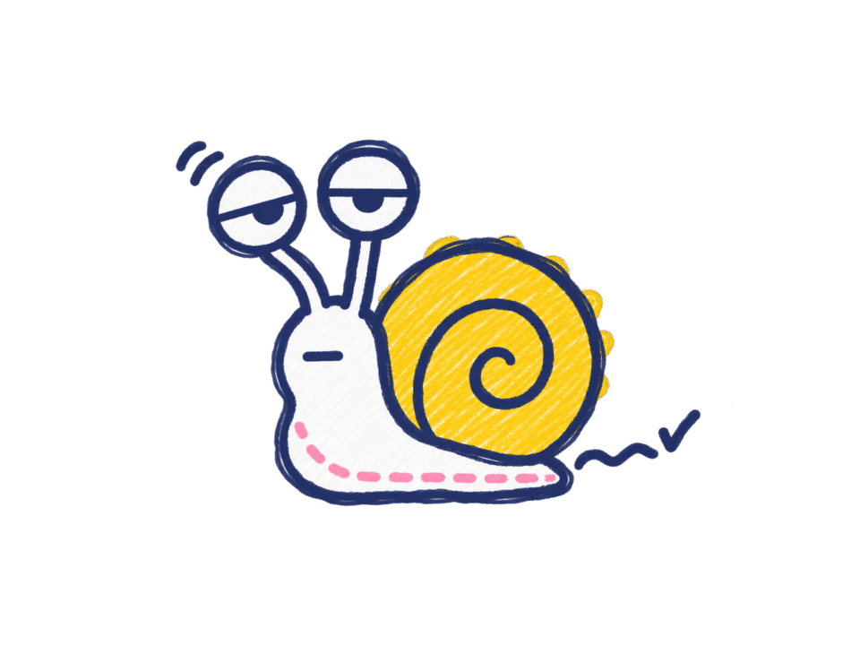<br>
  <sub>Made with crayons and a sigh. Built on the Open Knowledge Format.</sub>
</p>
